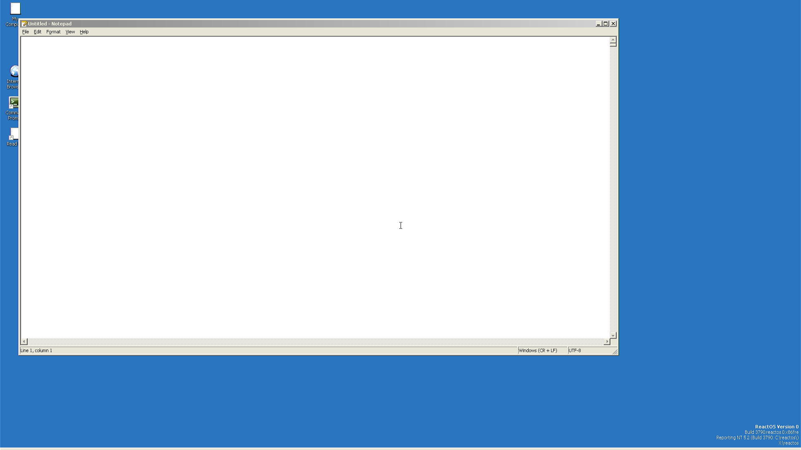
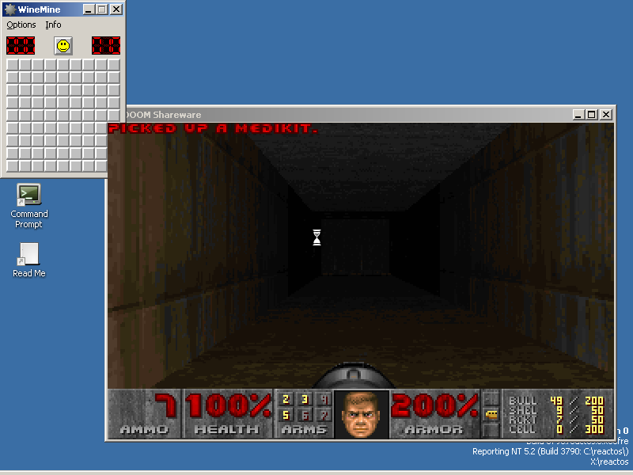
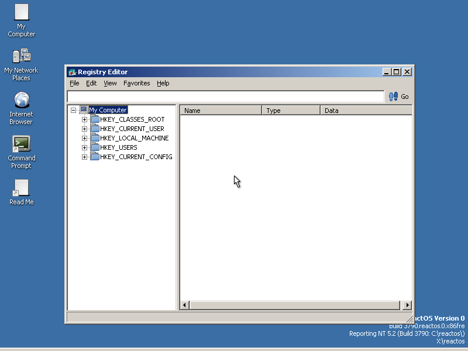
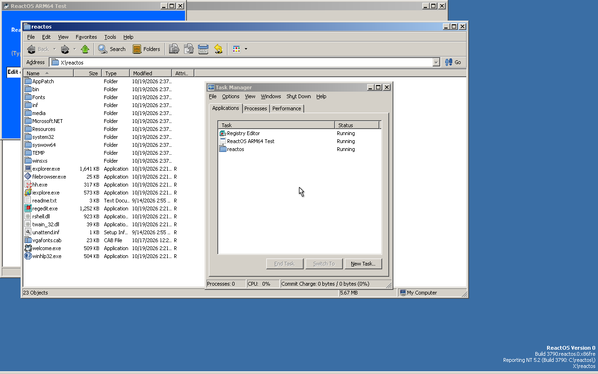

# vibeos

> *An operating system for nobody.*

An AI-vibecoded fork of [ReactOS](https://reactos.org/), the open-source Windows-compatible
operating system, that ports it to ARM64 and rewrites it in Rust. It is still ReactOS at heart:
the same NT architecture, the same Win32 API, the same goal of running Windows drivers and
applications. Only the language underneath, and the list of machines it boots on, have changed.
For fun, for science, and for absolutely no practical purpose.

> [!CAUTION]
> **Do not use this for anything. Ever.**
>
> This is an experimental research toy generated largely by LLMs (Claude, Codex, Gemini, Haiku,
> DeepSeek) running automated translation pipelines against the ReactOS C source. It is held
> together by static analyzers, differential test harnesses, boot smoke tests and `#[no_mangle]`
> incantations. **It is significantly less production-ready than upstream ReactOS, which is
> itself alpha-quality and explicitly warns against use on real hardware with real data.**
>
> If ReactOS says "may corrupt your hard disk," vibeos says "will absolutely brick your VM, eat
> your data, summon undefined behavior, and generate ud2 instructions in functions LLVM has
> decided are unreachable." Run it in a throwaway VM, or on a Raspberry Pi you don't love.

---

## Screenshots

Real hardware first: a **physical Raspberry Pi 5**, captured over HDMI at 1080p.



| Doom on ARM64 (doomgeneric, Win32 GDI) | Registry Editor on ARM64 |
|---|---|
|  |  |

| Explorer, Task Manager and System Properties on amd64 |
|---|
|  |

The QEMU shots are from `appstorm`, the payload that opens and closes about 50 stock applications and Control Panel applets on every arch.

---

## Status (October 2026)

**All three architectures boot to a graphical desktop, and the boot path is entirely Rust.**
The kernel and HAL compile zero lines of C. One smoke harness boots i386, amd64 and ARM64 with
two CPUs each and requires the same real marker on every arch: explorer's `_tWinMain` entered
and `shell ready` (no idle-detection proxies, no per-arch shortcuts). ARM64 gets there in about
40 seconds under QEMU.

| Platform | State |
|---|---|
| **QEMU i386, amd64, ARM64** | Desktop on all three, `-smp 2`, gated on every merge. amd64 boots under both UEFI and SeaBIOS, and installs from the boot CD onto a blank disk. |
| **Raspberry Pi 4B** (physical) | Desktop on all four cores; USB keyboard, mouse and mass storage; Ethernet; SD card writes. Network-booted from the build host in about 100 s. |
| **Raspberry Pi 5** (physical) | Desktop at 1080p over HDMI; USB, SD card, and Ethernet through the RP1 southbridge. |
| **Dell OptiPlex 9020** (physical x86) | Desktop; Realtek's own Windows 10 Wi-Fi driver joins a WPA2 network through a from-scratch Rust supplicant. |

### Rust translation

**55% of the core OS is Rust, and 89% of the ReactOS-native part.** What is left is mostly
Wine-derived userland (22% covered) and the DirectX stack. The tree holds 4.1M
lines of translated Rust (plus 10M lines of generated bindings, which we don't count).

| Surface | Rust |
|---|---:|
| Kernel (`ntoskrnl.exe`), HAL, `ntdll.dll`, CSR | 100% |
| win32k: USER / GDI / display drivers | 99–100% |
| Control Panel applets, keyboard layouts, OpenGL | 100% |
| Shell, CTF/IME, print spooler, AppCompat | 96–98% |
| Boot loader (freeldr) | 96% |
| Driver fleet (storage, filesystems, input, USB, network) | 95% |
| Services | 92% |
| In-box applications | 81% |
| Setup | 51% |
| Win32 DLLs (mostly Wine) | 34% |
| DirectX | 0% |

*Lines of compiled C replaced by Rust, from `python3 tools/port_audit.py` at 2026-10-18.*

The per-module ledger, generated from the build graph and stamped with its commit, is
[`docs/engineering/rust-port-status.md`](docs/engineering/rust-port-status.md).

### Compatibility

vibeos keeps ReactOS's compatibility target and measures it rather than assuming it:

- **Conformance ratchets.** ReactOS's kernel-mode tests (kmtest), 62 user-mode apitest suites
  and all 128 Wine winetest suites build and run inside the booted guest. Per-assertion results
  are baselined per arch, and a merge that turns a passing assertion red is rejected.
- **Rust against its own C.** For a translated module, the original C is built alongside as a
  reference and both run the same test in the same guest. setupapi's Wine test suite produces
  byte-identical output from the Rust and the C. On the host, `difftest` grades shipping Rust
  against the genuine C it replaced, with mutants to prove each test can fail.
- **Real Windows binaries.** Doom (doomgeneric, Win32 GDI) runs as a payload; `appstorm` opens
  and closes about 50 stock applications and Control Panel applets on every arch; on ARM64,
  stock **x86-64** Windows programs run through [FEX](https://github.com/FEX-Emu/FEX).

## Recent wins

- 🍓 **Boots on a real Raspberry Pi 4**: all four cores, USB, Ethernet, SD card, about 100 s from power-on to desktop.
- 🍓 **And a Raspberry Pi 5**: 1080p HDMI, USB, SD, Ethernet through RP1 at 360 of 360 pings.
- 📶 **A real x86 PC gets online over Wi-Fi**: Realtek's stock Windows 10 driver plus a from-scratch Rust WPA2 supplicant.
- 🔀 **Stock x86-64 Windows apps run on ARM64** under FEX: 25 of them, as real x86-64 processes.
- 🦀 **The boot path is all Rust**: the kernel and HAL compile zero lines of C.
- ⚙️ **The kernel links with Cargo**: kernel, core binaries, drivers and `win32k.sys` are byte-identical to the CMake build apart from the timestamp.
- 🪟 **user32, comctl32, msvcrt and ucrtbase are Rust**, and the C runtimes link no C at all.
- 📝 **Whole apps translate for pocket change**: Notepad cost about $0.20, then Paint, the Control Panel and C++/ATL shell extensions.
- 🧠 **Multiprocessor boots on all three arches**, and every merge is gated on two-CPU boots.
- 🐛 **A 453-boot soak caught an inherited lock that never locked**: dead code in ReactOS, live once a second CPU exists.
- 🔒 **61 invented crash codes caught**, and constants no longer pass through the model at all.
- 🧪 **The conformance suites gate merges**: 62 apitest suites that had never run (they found a win32k crash immediately) and all 128 winetest suites.
- 🔁 **Upstream ReactOS fixes are used to find bugs**: one sync wave found eleven, two of them crash-class.
- 💿 **Installs onto a blank disk** from the boot CD, and the installed system boots to the desktop.
- 👹 **Doom runs.** Of course it does.

## How it's built

The C is translated function by function by an LLM pipeline (`tools/rustconv/`), and most of
the engineering is in making that output trustworthy without a human reading every line:

- **Deterministic first, paid last.** Constants, struct layouts, call targets, COM vtables and
  wide-string literals are extracted from the C and *sealed*. They never pass through the model,
  and a body that drops or invents one is rejected. Trivial bodies are lowered for free; a
  bounded repair pass fixes compile errors before anything is re-bought. Translating a typical
  DLL now costs cents (Notepad: about $0.20).
- **Cohabitation.** A translated file's C stays on disk, commented out of the build, while the
  Rust takes over its symbols. Any module can be half-translated and still boot.
- **Static defenses.** Struct layouts and FFI signatures in the Rust are checked against the C
  headers generated by the same commit, and a Rust lint binary (`tools/vibeos-lint`) catches
  LLVM miscompile classes, invented constants and ABI drift before a boot is ever attempted.
- **Runtime tripwires** for the hard bugs: lockdep, waitdep, special pool (fault at the
  corrupting store, not minutes later), and a flake farm that soaks boots into a corpus and
  grades each failure FLAKE or DETERMINISTIC.
- **One front door.** `./vibeos-cli` builds, boots, smokes, gates, debugs (GDB over the real
  UEFI boot), drives the Pi benches, and refuses to boot stale media.

## What this is *not*

- A usable operating system.
- A drop-in replacement for ReactOS. Most of the value here is in the experimental scaffolding
  (translation pipeline, multi-arch toolchain, test harnesses), not the resulting binaries.
- An attempt to compete with, replace, or upstream into ReactOS. We sync from upstream
  regularly, and use each upstream fix as a bug report against our Rust. Branding, donation
  links and project infrastructure from upstream have been stripped because none of it applies
  to this fork.
- Affiliated with or endorsed by ReactOS, the ReactOS Foundation, Microsoft, or anyone else
  with a legal department.

## Building (for the curious)

Builds from Linux or WSL2. Requires [`llvm-mingw`](https://github.com/mstorsjo/llvm-mingw)
(20250114, LLVM 19), Rust 1.92 (pinned in `rust-toolchain.toml`, with the
`aarch64-pc-windows-gnullvm`, `x86_64-pc-windows-gnu` and `i686-pc-windows-gnu` targets), and
`qemu-system-{aarch64,x86_64,i386}`. See
[`docs/engineering/agent-reference.md`](docs/engineering/agent-reference.md) for the full setup.

```bash
./vibeos-cli build  --arch arm64      # or amd64 / i386  (--clean for a cold link)
./vibeos-cli smoke  --arch arm64      # the verdict: boots to desktop, refuses stale media
./vibeos-cli smoke  --arch amd64 --payload appstorm   # media built with VIBEOS_PAYLOAD=appstorm
./vibeos-cli gate                     # build and smoke all three arches
```

## Further reading

- [`docs/engineering/rust-port-status.md`](docs/engineering/rust-port-status.md): Rust-vs-C coverage per module (generated)
- [`docs/product/vibeos-roadmap.md`](docs/product/vibeos-roadmap.md): where this is going, and the live known-bugs registry
- [`docs/engineering/translation-debugging-field-manual.md`](docs/engineering/translation-debugging-field-manual.md): every class of translation bug we have eaten, symptom first
- [`docs/engineering/rustconv-pipeline.md`](docs/engineering/rustconv-pipeline.md): the translation pipeline
- [`AGENTS.md`](AGENTS.md): the rules the AI agents working on this repo follow, and the incidents behind each one

## License

The original ReactOS code is licensed under [GNU GPL 2.0](COPYING). All modifications in this
fork inherit that license.

The vibecoded slop is provided as-is, with no warranty of any kind, and in particular no
warranty that the code does what its function names suggest.
