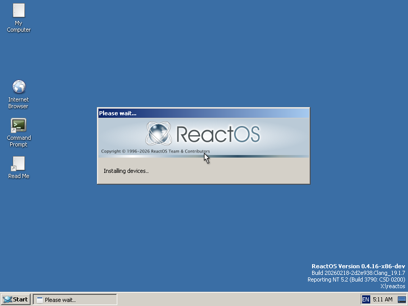
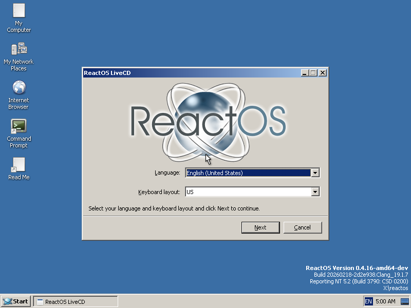
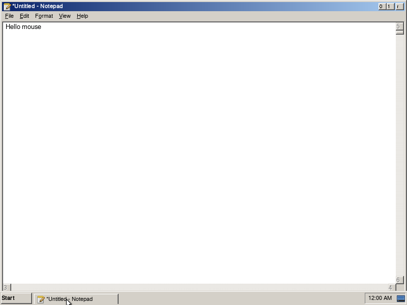
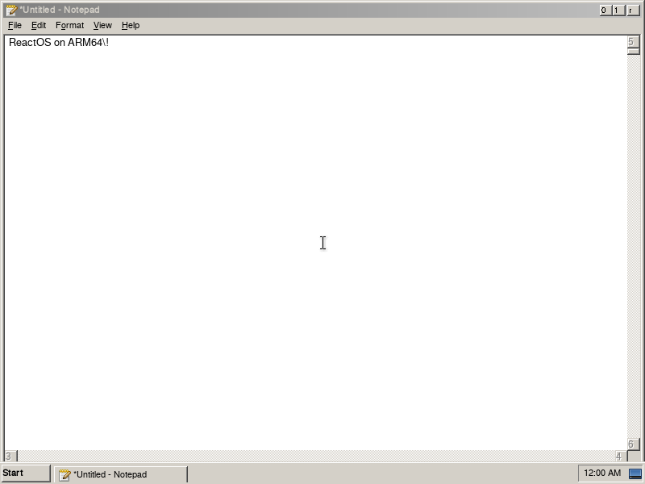

# vibeos

> *An operating system for nobody.*

An AI-vibecoded fork of [ReactOS](https://reactos.org/) that ports the kernel to ARM64 and rewrites most of it in Rust — for fun, for science, and for absolutely no practical purpose.

> [!CAUTION]
> **Do not use this for anything. Ever.**
>
> This is an experimental research toy generated largely by LLMs (Claude, Codex, Gemini) running automated translation pipelines against the ReactOS C source. The kernel is held together by static analyzers, smoke tests, and `#[no_mangle]` incantations. **It is significantly less production-ready than upstream ReactOS, which is itself alpha-quality and explicitly warns against use on real hardware with real data.**
>
> If ReactOS says "may corrupt your hard disk," vibeos says "will absolutely brick your VM, eat your data, summon undefined behavior, and generate ud2 instructions in functions LLVM has decided are unreachable." Run it in a throwaway QEMU and nowhere else.

---

## Screenshots

All three architectures boot to a graphical desktop in the QEMU smoke harness — **arm64 reaches the same real `shell ready` marker as x86**, not an idle-detection proxy.

| i386 LiveCD desktop | amd64 LiveCD desktop |
|---|---|
|  |  |

| ARM64 desktop | ARM64 Notepad |
|---|---|
|  |  |

ARM64 was the original target — bringing up an NT-style kernel on a non-x86 architecture from a codebase that had never built for one before. It now boots to the same graphical desktop as x86 in ~40s under QEMU `virt`, with real GIC interrupts (routing + dispatch + hardware-backed IRQL), a PL031 real-time clock, and USB HID keyboard/mouse input through the Rust USB host stack.

---

## What this is

A multi-architecture port of ReactOS — an open-source Windows-compatible operating system — with two parallel goals:

1. **ARM64 port.** Cross-compile the entire NT-compatible kernel and userspace to AArch64 PE-COFF using `llvm-mingw`. Boot under QEMU `virt`. Also retains amd64 and i386 builds; all three target zero build failures and pass smoke tests independently.
2. **Rust in the kernel.** Translate the C source of `ntoskrnl` (and the HAL) to Rust subsystem-by-subsystem using an automated LLM pipeline (`tools/rustconv/`), then link the result into the kernel. `ntoskrnl.exe` now **links via cargo with zero cmake-built static libraries** and consumes only a handful of tiny C shim files — every subsystem (`ob`, `se`, `ps`, `ex`, `ke`, `mm`, `cc`, `fsrtl`, `iomgr`, `pnpmgr`, `config`, `kd`, `kdbg`, `kd64`, `lpc`, `dbgk`, `po`, `wmi`, `vdm`, `rtl`, etc.) is Rust. The kernel monolith crate is being split per-subsystem for build velocity (~70% extracted, ~250-member cargo workspace). The HAL is Rust on **all three arches** — x86 (i386 + amd64) and arm64 (GIC/timer/DMA-adapter/PL031). Dozens of sibling rlibs under `sdk/lib/rust/` factor out reusable primitives (slist, bitmap, splaytree, generictable, avltable, mm-avl, etc.).

The translation pipeline produces transliterated Rust that mostly preserves the original C structure, with subsequent passes for probe migration, RAII guards, and idiomatic NTSTATUS handling. It is held together by:

- ~1,500 compile-time struct layout assertions per architecture (bindgen-generated).
- A custom static-analysis suite (`scan_ud2.py`, `lint_kernel.py`, `verify_constants.py`, `verify_ffi.py`, etc.) for catching LLVM miscompilations and FFI mismatches, plus bespoke runtime tripwires (lockdep, waitdep, cswitchdep, special-pool) for the hard concurrency/corruption bugs.
- QEMU smoke tests (`tests/qemu/test_smoke.py`, driven by `./vibeos-cli`) that boot each arch end-to-end and require a graphical desktop to count as passing.

## What this is *not*

- A usable operating system.
- A drop-in replacement for ReactOS — most of the value here is in the experimental scaffolding (translation pipeline, multi-arch toolchain, smoke harness), not the resulting binaries.
- An attempt to compete with, replace, or upstream into ReactOS. Branding, donation links, and project infrastructure from upstream have been stripped because none of it applies to this fork. The original code is GPL-2.0; see [`COPYING`](COPYING).
- Affiliated with or endorsed by ReactOS, the ReactOS Foundation, Microsoft, or anyone else with a legal department.

## Status

> [!NOTE]
> **Active development is intermittent.** The repo is generally kept in a state where all three architectures build cleanly and pass the smoke harness, but the smoke harness's bar varies a lot by arch (see below). It may go quiet again at any time.

Current per-arch boot state (HEAD as of July 2026):

- **i386 — full graphical desktop** with start menu and taskbar. LiveCD ISO boots the full chain (kernel → SMSS → CSRSS → win32k → winlogon → explorer → desktop with shell).
- **amd64 — full graphical desktop.** Same chain, same outcome.
- **ARM64 — full graphical desktop.** Reaches the *same* real `shell ready` marker as x86 (not idle-detection — that's retired lore), in ~40s under QEMU `virt`, with real GIC interrupts, RTC clock, and USB HID input.

All three are driven by one smoke harness (`./vibeos-cli gate` builds serially, then boots all arches in parallel); the boot marker is `[EXPLORER] _tWinMain entered` + `shell ready` on **every** arch.

Other status:

- **Build:** All three arches build cleanly from Linux/WSL2 with the unified `llvm-mingw` toolchain (Clang 19 / lld 19.1.7, rustc 1.92 / LLVM 21). Zero build failures. Builds run at a canonical bind-mount path with a mandatory shared ccache/sccache; the front door is `./vibeos-cli build`.
- **Rust coverage:** `ntoskrnl.exe` links via cargo with zero cmake static libs (only a few tiny C shims remain); every subsystem is Rust; the monolith crate is ~70% split into per-subsystem crates. The HAL is Rust on all three arches.
- **LLVM defenses:** the captures(none) miscompile class (ud2 in named functions, dropped output-pointer writes) is **toolchain-fixed on LLVM ≥ 21** (we ship rustc 1.92 / LLVM 21.1.3); the `lto = false` + `codegen-units = 256` workspace firewall stays as belt-and-suspenders (it still guards the toolchain-independent ABI-mismatch ud2 cascade), backed by `scan_ud2.py`/`lint_kernel.py` in the smoke harness.
- **Smoke harness:** Boot marker is `shell ready` on **all three arches** (proves kernel → user-mode → desktop). Static analysis (ud2 scan, sacred-primitives, FFI/constant checks) runs as a blocking lint gate before boots and gates regressions.

For a deeper look, see:

- [`docs/engineering/rust-port-status.md`](docs/engineering/rust-port-status.md) — the single source of truth for current Rust-vs-C coverage per subsystem
- [`docs/product/vibeos-roadmap.md`](docs/product/vibeos-roadmap.md) — what this could become (+ the live Check-back ledger and Known-bugs registry)
- [`docs/product/vibeos-roadmap-complete.md`](docs/product/vibeos-roadmap-complete.md) — what's already shipped
- [`docs/engineering/`](docs/engineering/) — the ~11 living reference docs (field manual, kernel-Rust patterns, build system, debug infrastructure); `docs/engineering/active-lanes/` for in-flight work, `docs/engineering/archive/` for closed lanes
- [`AGENTS.md`](AGENTS.md) — the long-form context document used by AI agents working on this repo (also the best single-page summary of how everything fits together)

## Building (for the curious)

Requires `llvm-mingw` (Clang 19+), `windmc` from Homebrew `mingw-w64`, `cargo` with the `aarch64-pc-windows-gnullvm`, `x86_64-pc-windows-gnu`, and `i686-pc-windows-gnu` targets, plus `qemu-system-{aarch64,x86_64,i386}`. See [`AGENTS.md`](AGENTS.md) for the full setup.

The unified front door is **`./vibeos-cli`** (build / smoke / check / gate / debug). It handles the canonical build path, shared cache, and per-arch boot media automatically:

```bash
./vibeos-cli build  --arch arm64      # or amd64 / i386  (--clean for a cold link)
./vibeos-cli smoke  --arch arm64      # the verdict — boots to desktop, refuses stale media
./vibeos-cli gate                     # build ×3 serial → smoke all arches in parallel
```

Raw ninja still works, but a canonical build dir must be entered through the mount wrapper (plain `cd build-<arch> && ninja` fails loudly by design — its baked paths only exist inside the mount):

```bash
cd build-amd64 && bash ../tools/canon-run.sh ninja livecd
```

## License

The original ReactOS code is licensed under [GNU GPL 2.0](COPYING). All modifications in this fork inherit that license.

The vibecoded slop is provided as-is, with no warranty of any kind, and in particular no warranty that the code does what its function names suggest.
